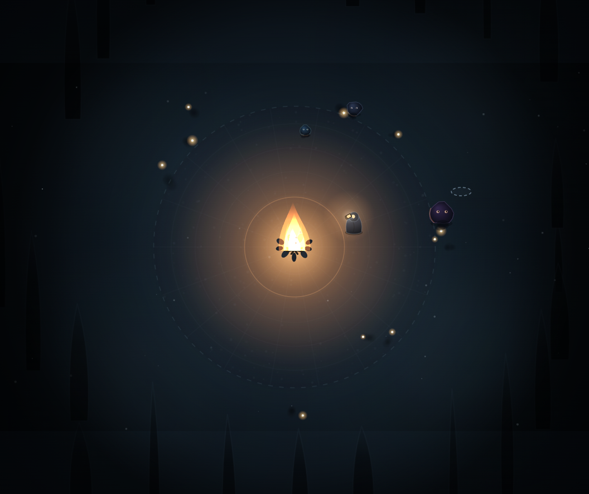

# 守灯 · Lanternwatch

一局约五到六分钟的网页小游戏。你是一位提灯人，守着一簇不肯熄灭的火，用灯焰把从林子里爬出来的影子烧退。

纯 Canvas 2D，零运行时依赖，音效全部用 Web Audio 程序化生成。



## 运行

需要 Node 18+（只用来起一个静态服务器，游戏本身不依赖 Node）。

```bash
# 方式一：双击
start.bat

# 方式二
npm start        # 起服务并打开浏览器
npm run serve    # 只起服务，然后访问 http://localhost:4321
```

> 不能直接双击 `index.html`：项目用 ES modules，`file://` 协议会被浏览器拦下。

## 怎么玩

| 操作 | 说明 |
| --- | --- |
| `W A S D` / 方向键 | 在火光周围移动 |
| 鼠标移动 | 瞄准 |
| 按住鼠标左键（或 `J`） | 照射灯焰，持续消耗灯油 |
| `空格` / 鼠标右键 | 冲刺：穿过影群造成伤害，短暂无敌 |
| `Esc` / `P` | 暂停 |
| `1` `2` `3` | 在遗物界面选卡 |

- **胜利**：熬过八夜，烧掉终夜的影王。
- **失败**：火堆血量归零，或者你倒下。
- **核心循环**：照射耗油 → 击杀掉余烬 → 走近拾取回油 → 继续照射。
- **火堆不是安全屋**：影子扑到火堆会直接扣火的血，你得在它们到达之前拦住。

## 自验证（agent 验收用）

游戏本体暴露了两个钩子，和 `CLAUDE.md` 里写的一致：

```js
window.render_game_to_text()  // 当前状态 JSON
window.advanceTime(ms)        // 按 1/60 固定步长确定性推进
```

调试接口在 `window.__lantern`：

```js
__lantern.start()          // 开一局
__lantern.startAt(5)       // 直接跳到第 6 夜（QA 用，不计入最佳记录）
__lantern.bot(true)        // 让机器人接管输入
__lantern.snapshot()       // 渲染并返回 canvas dataURL
__lantern.crop(x, y, w, h) // 世界坐标局部放大
__lantern.jump(n)          // 只改波次，不重置一局
```

命令行验证：

```bash
npm test           # 11 条模拟 / 数据 / 存档测试
npm run balance    # 200 局机器人对战，输出通关率与波次分布
node server.mjs --qa   # 开启 POST /__shot，把截图落到 shots/
```

`--qa` 会在本地起一个只写 `shots/*.png` 的端点，默认关闭；线上部署不要带这个参数。

## 目录

```
index.html          页面骨架与所有界面文案
src/
  main.js           入口：输入映射、主循环、界面切换、验收钩子
  sim.js            纯逻辑：固定步长、固定种子、事件流（不碰 DOM）
  render.js         纯渲染：读状态、画画面与粒子（不影响模拟）
  audio.js          程序化音效与低频氛围
  data.js           所有数值：敌人、波次、遗物、基础参数
  save.js           版本化存档与迁移链
  util.js           随机数、数学工具
  style.css         界面样式
tests/
  sim.test.mjs      确定性、不变量、波次、遗物、存档
  balance.mjs       无头批量对局
GAME_DESIGN.md      一页纸范围与数值表
NEXT_GAME.md        想到但这次不做的点子
CLAUDE.md           给下一个 agent 的短指南
```

## 已知边界

- 只做桌面 + 平板触屏的触控映射；没有做手柄。
- 音效是程序化合成，听感偏复古，不是真实录音。
- 没有排行榜和后端，最佳记录只存在本机 `localStorage`。
- 最佳记录、设置做了版本迁移；局内状态刻意不存档（一局五分钟，重开比断点续玩更合适）。
